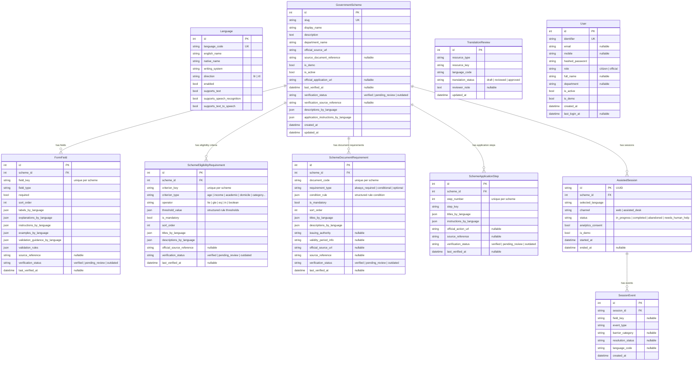

# NagrikSaarathi — Database ERD

> Entity-Relationship Diagram for the NagrikSaarathi database layer including Guided Self-Application mode.

## Privacy Guarantees

| Table | Privacy Guarantee |
|---|---|
| `assisted_sessions` | **Zero PII.** No form answers, documents, names, phones, addresses, or identity numbers. |
| `session_events` | **Structured events only.** Never stores actual values or documents entered by citizens. |
| Guided Self-Application | Fully operable without user registration; application answers remain in client-side memory. |
| All analytics | Created only after explicit `analytics_consent = true`. |
| Demo data | Always distinguished by `is_demo = true`. |
